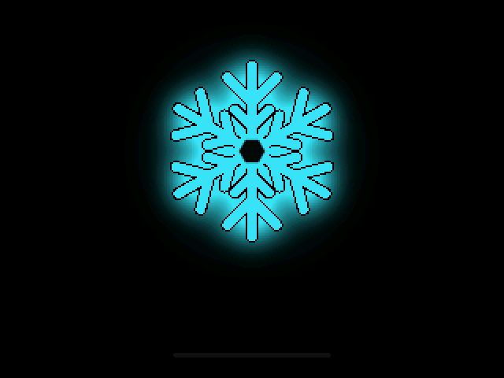
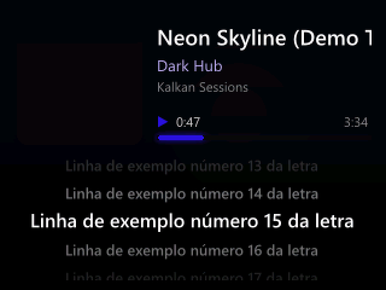
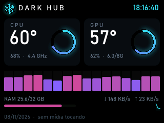
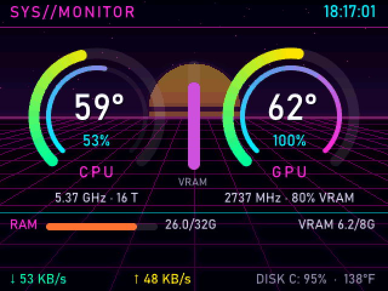
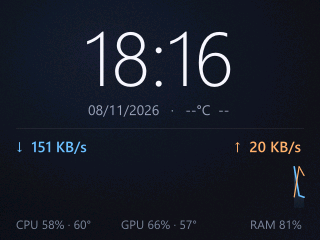
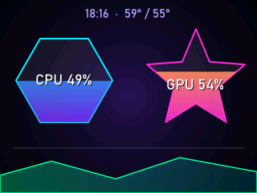
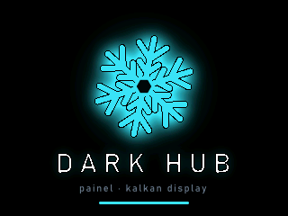
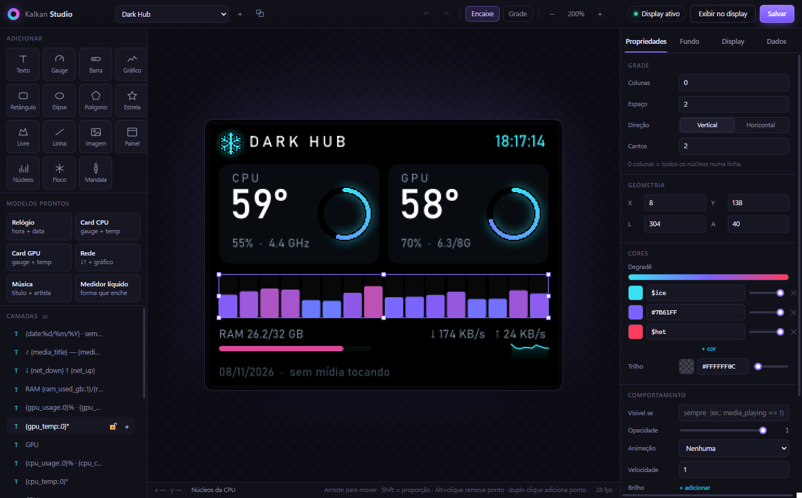

<div align="center">



# Kalkan-RS · Dark Hub

**Painel e driver de alta performance, em Rust, para o display AIO KALKAN / GAMDIAS ZEUS CAST (320×240)**
Substitui o software oficial (WPF, 400 MB+ de RAM) por um serviço nativo de ~22 MB e um editor visual no estilo canvas.


</div>

---

## ✨ Destaques

| | |
|---|---|
| ⚡ **Leve** | ~22 MB de RAM e ~0,04% de CPU com temas estáticos. Sem .NET, sem ffmpeg. |
| 🎨 **Extremamente customizável** | Temas em TOML com camadas, expressões, condições, regras de cor, animações, brilho, paleta e formas livres. |
| 🖌️ **Kalkan Studio** | Editor visual: arrastar, redimensionar, guias magnéticas, camadas, desfazer/refazer e pré-visualização idêntica ao display. |
| 🎞️ **Mídia** | MP4/H.264/HEVC via Media Foundation, GIF/WebP/APNG com cache, imagens estáticas. |
| 📊 **Telemetria completa** | CPU (uso por núcleo, clock, temperatura), GPU (NVIDIA/AMD/Intel), RAM, disco, rede, música tocando e clima. |
| 🔁 **Hot-reload** | Salvou o tema, o display atualiza na hora. O `config.toml` também é aplicado ao vivo. |
| 🎵 **Modo música** | Capa, player com tempo/duração e **letra sincronizada** (karaokê), com fundo e cores que se adaptam à capa. Entra sozinho quando você dá play. |
| 🧊 **Tela de inicialização Dark Hub** | Floco animado com brilho, e você pode editar ou trocar como qualquer outro tema. |

## 🖼️ Galeria

| Now Playing | Dark Hub | Cyberpunk |
|:-:|:-:|:-:|
|  |  |  |
| **Minimal Clean** | **Neon Shapes** | **Tela de inicialização** |
|  |  |  |

<sub>Imagens do Now Playing geradas com `KALKAN_DEMO_MEDIA=1` (faixa, capa e letra fictícias).</sub>

<p align="center"></p>

## 🚀 Começando

### Requisitos
- Windows 10/11 x64 com o display KALKAN/GAMDIAS conectado (aparece como uma porta COM).
- O software oficial **instalado**, porque o kalkan-rs usa a `LcdComm.dll` dele, que não é redistribuída aqui. Ela é procurada em `C:\Program Files\KALKAN\`, na pasta do executável ou no caminho definido em `dll_path`.
- **Feche o software oficial.** Dois programas não podem usar a mesma porta COM ao mesmo tempo.
- Para compilar: [Rust](https://rustup.rs) estável (toolchain MSVC). O WebView2 (necessário para o Studio) já vem no Windows 11.

### Compilar

```bash
cargo build --release --workspace
```

Gera `target\release\kalkan-rs.exe` (serviço, ~2,5 MB) e `target\release\kalkan-studio.exe` (editor). Mantenha os dois na mesma pasta, junto com a pasta `assets\`.

### Usar

```bash
target\release\kalkan-rs.exe
```

O ícone aparece na bandeja do Windows. Pelo menu dá para trocar tema, brilho, FPS, rotação, inverter/espelhar a imagem, ativar o modo silencioso, abrir o **Kalkan Studio** e recarregar. Para iniciar junto com o Windows, coloque um atalho em `shell:startup`.

| Comando | Efeito |
|---|---|
| `kalkan-rs` | Inicia o serviço com ícone na bandeja |
| `kalkan-rs --theme dark_hub` | Inicia com um tema específico |
| `kalkan-rs --no-tray` | Sem bandeja (Ctrl+C encerra) |
| `kalkan-rs --preview <tema> [saida.png]` | Renderiza o tema em PNG, sem hardware, e mede o tempo |
| `kalkan-rs --record <tema> <saida.gif> [s]` | Grava a animação do tema em GIF |
| `kalkan-rs --list-themes` | Lista os temas |
| `kalkan-rs --verbose` | Log detalhado em `kalkan-rs.log` |
| `kalkan-studio` | Abre o editor visual |

Use `splash` como nome de tema para pré-visualizar ou gravar a tela de inicialização.

## ⚙️ Configuração

O `config.toml` é criado ao lado do executável. Copie [`config.example.toml`](config.example.toml) para ver todas as opções. As principais:

| Chave | Padrão | Descrição |
|---|---|---|
| `active_theme` | `"cyberpunk"` | Pasta do tema em `assets/themes/` |
| `brightness` | `80` | Brilho do painel (0–100) |
| `max_fps` | `24` | FPS máximo (1–30). Fundos animados custam CPU proporcional ao FPS |
| `rotation` | `0` | Rotação de hardware: 0/90/180/270 |
| `flip_vertical` / `flip_horizontal` | `true` / `true` | Orientação do painel (180° na montagem padrão) |
| `splash` / `splash_ms` | `true` / `2600` | Tela de inicialização e duração em ms |
| `music_mode` / `music_theme` | `true` / `"now_playing"` | Troca para o tema de música enquanto algo toca |
| `music_return_s` | `8` | Segundos pausado até voltar ao tema normal |
| `lyrics` | `true` | Busca letras sincronizadas no [LRCLIB](https://lrclib.net) (envia título/artista) |
| `gpu_backend` | `"auto"` | `auto` (D3DKMT, leve), `nvml` (watts e fan %, +19 MB de RAM) ou `pdh` |
| `weather_lat` / `weather_lon` | — | Liga o clima (Open-Meteo, sem chave de API) |

Mudanças feitas pela bandeja ou pelo Studio são gravadas aqui, e o serviço aplica em cerca de 1 s.

## 🎨 Temas em 30 segundos

Cada pasta `assets/themes/<nome>/` que contém um `theme.toml` é um tema. Os recursos mais usados:

```toml
[meta]
name = "Meu tema"
font = "bahnschrift.ttf"          # fonte padrão dos textos

[palette]                          # cores nomeadas, usadas como $nome
accent = "#38E1F0"

[background]
type = "video"                     # video | gif | static | solid
path = "bg.mp4"
dim = 0.3

[[widgets.text]]
text = "{cpu_temp:.0}°C  ({cpu_temp*1.8+32:.0}°F)"   # placeholders aceitam expressões
x = 160
y = 120
align = "center"
color_hex = "$accent"
color_rules = [{ when = "cpu_temp >= 85", color = "#FF3B5C" }]  # cor condicional
glow = "$accent"                                                 # brilho

[[widgets.text]]
text = "♪ {media_title}"
x = 10
y = 220
max_width = 300
visible_if = "media_playing == 1"   # só aparece com música tocando
animation = "marquee"               # rola se não couber

[[widgets.shape]]                   # forma livre
kind = "star"
x = 130
y = 60
width = 60
height = 60
fill_gradient = ["#FFE600", "#FF2BD6"]
metric = "gpu_usage"                # enche conforme o uso
animation = "spin"
```

**Tipos de camada:** `text`, `radial_gauge`, `bar`, `sparkline`, `cores`, `shape`, `rect`, `image`, `album_art` e `lyrics`.

**Música:** fundo `type = "album"` (capa desfocada), cores `$album_vibrant`, `$album_light`, `$album_dark`, `$album_dominant` (extraídas da capa) e placeholders `{media_position_str}`, `{media_duration_str}` e `{lyrics_line}`.

**Comportamentos disponíveis em qualquer camada:** `visible_if`, `color_rules`, `animation` (`pulse`, `blink`, `spin`, `marquee`, `fade_in`, `slide_up`), `glow`, `layer_opacity`.

📖 **Referência completa:** [docs/THEMES.md](docs/THEMES.md) · **Editor:** [docs/STUDIO.md](docs/STUDIO.md)

## 📈 Desempenho

Medições em um Ryzen de 16 threads com uma RTX 5060:

| Cenário | CPU total | RAM privada |
|---|---|---|
| Tema estático (relógio, telemetria) | ~0,04% | ~19 MB |
| Fundo animado, 24 fps | ~0,3–0,45% | ~22 MB |
| Modo música (capa, player, letra) | ~0,1% | ~23 MB |
| Conversão de um quadro para RGB565 (AVX2) | ~8 µs | — |

Cerca de 85% da CPU gasta em fundos animados é do driver USB do Windows (`usbser.sys`), e esse custo é proporcional aos bytes enviados. Por isso o FPS é configurável e quadros repetidos não são reenviados. Os detalhes estão em [docs/PROTOCOL.md](docs/PROTOCOL.md).

## 🗂️ Documentação

| Documento | Conteúdo |
|---|---|
| [docs/THEMES.md](docs/THEMES.md) | Referência de todas as camadas, propriedades, placeholders, expressões e animações |
| [docs/STUDIO.md](docs/STUDIO.md) | Guia do editor visual e atalhos |
| [docs/ARCHITECTURE.md](docs/ARCHITECTURE.md) | Threads, pipeline de renderização, telemetria e mídia |
| [docs/PROTOCOL.md](docs/PROTOCOL.md) | Engenharia reversa da `LcdComm.dll` e do protocolo USB |
| [CHANGELOG.md](CHANGELOG.md) | Histórico de versões |

## ⚖️ Aviso

Projeto independente, sem afiliação com a GAMDIAS ou a KALKAN. Ele não inclui nem redistribui arquivos do fabricante: usa a `LcdComm.dll` já instalada no seu computador. Use por sua conta e risco.

Licenciado sob a [MIT](LICENSE).
