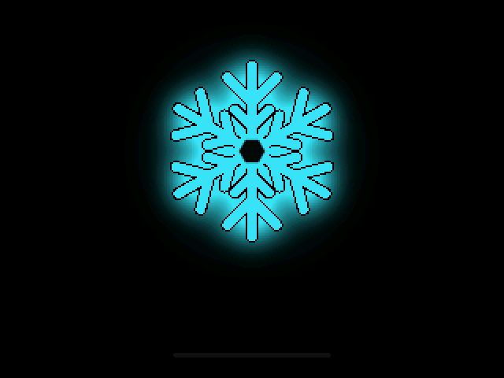
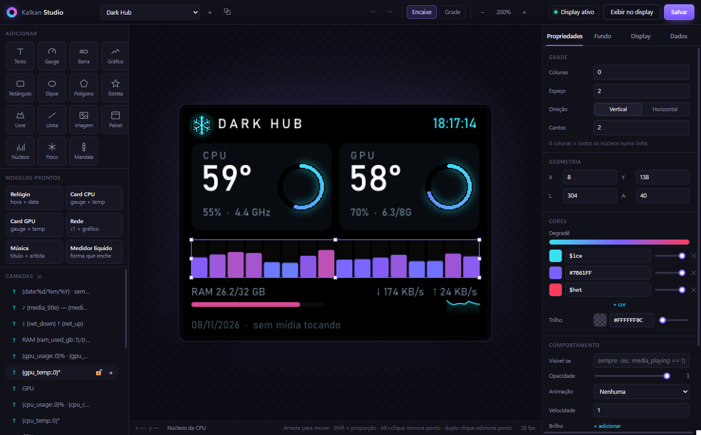
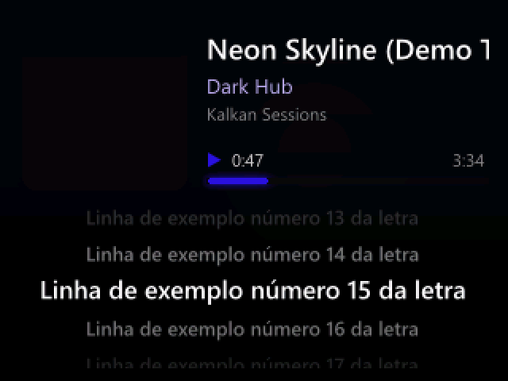
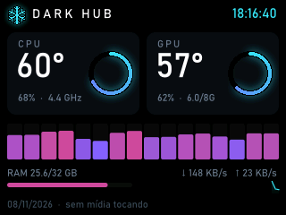
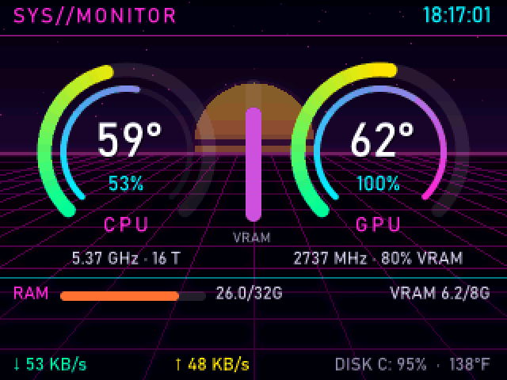
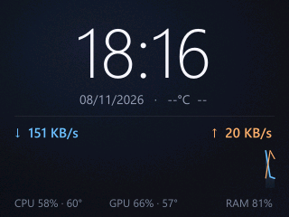
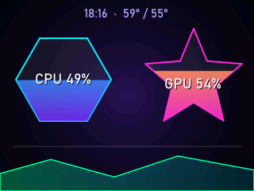
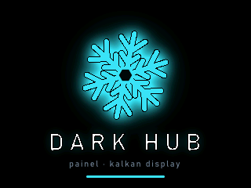
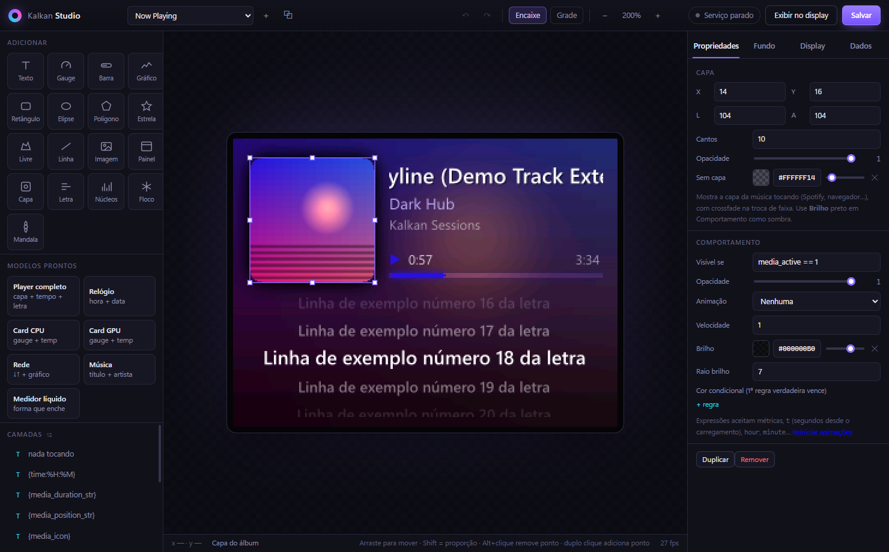

<p align="center">
  
</p>

<h1 align="center">Kalkan-RS</h1>

<p align="center">
  Painel e driver leves, escritos em Rust, para o display do water cooler <b>Kalkan Aura LCD 240</b>.<br/>
  Substitui o software oficial (WPF, 400 MB+ de RAM) por um serviço nativo de ~22 MB e um editor de temas no estilo canvas.
</p>

<p align="center">
  <a href="https://github.com/Pokeralho/kalkan-rs/releases/latest"></a>
  <a href="https://github.com/Pokeralho/kalkan-rs/releases"></a>
  <a href="./LICENSE"></a>
  
  
</p>

<p align="center">
  <a href="./README.md">English</a> · <b>Português</b>
</p>

<p align="center">
  <a href="#instalação">Instalação</a> ·
  <a href="#recursos">Recursos</a> ·
  <a href="#temas">Temas</a> ·
  <a href="#kalkan-studio">Studio</a> ·
  <a href="#configuração">Configuração</a> ·
  <a href="#desempenho">Desempenho</a> ·
  <a href="#compilando">Compilar</a>
</p>

<p align="center">
  
</p>

---

## Hardware

Feito para o water cooler **Kalkan Aura LCD 240**, que tem um display de 320×240 no bloco da bomba. O display usa USB `VID 0x1B80` / `PID 0xB550` e o Windows o expõe como uma porta COM serial.

O mesmo display e o mesmo protocolo aparecem no software GAMDIAS ZEUS CAST. Por isso, outros coolers que vêm com a mesma `LcdComm.dll` devem funcionar, mas apenas o Kalkan Aura LCD 240 foi testado.

## Instalação

1. Baixe `Kalkan-RS-x.y.z-win-x64.zip` da [última release](https://github.com/Pokeralho/kalkan-rs/releases/latest) e extraia em qualquer pasta (por exemplo, `C:\Tools\Kalkan-RS`).
2. Mantenha o **software oficial da Kalkan instalado**, mas **fechado**:
   - o Kalkan-RS conversa com o display pela `LcdComm.dll` do fabricante, procurada em `C:\Program Files\KALKAN\` e não redistribuída aqui;
   - dois programas não podem usar a mesma porta COM ao mesmo tempo.
3. Execute `kalkan-rs.exe`. Um ícone aparece na bandeja do Windows, e o display mostra a tela de inicialização e depois o tema ativo.

Para iniciar junto com o Windows, coloque um atalho do `kalkan-rs.exe` em `shell:startup`.

Requisitos: Windows 10 ou 11, 64 bits. O Kalkan Studio usa o WebView2, que já vem no Windows 11. No Windows 10, instale o [runtime Evergreen](https://developer.microsoft.com/microsoft-edge/webview2/) se o Studio não abrir.

---

## Recursos

### Serviço do display
- **Leve**: ~22 MB de RAM e ~0,04% de CPU com temas estáticos. Sem .NET e sem ffmpeg embutido.
- **Driver**:
  - quadros em triple buffer, que nunca travam a renderização;
  - keep-alive e reconexão automática quando o cabo USB volta;
  - quadros idênticos não são reenviados.
- **Menu da bandeja**: temas, brilho, FPS máximo, rotação, inverter/espelhar, modo silencioso, modo música automático, recarregar e atalho para o Kalkan Studio. Mudanças feitas pelo Studio no `config.toml` são aplicadas em até um segundo.
- **Tela de inicialização**: um floco animado do Dark Hub. É um tema comum, que pode ser editado ou trocado.

### Modo música
- **Now Playing**: capa do álbum, título, artista, tempo atual, duração, barra de progresso e **letra sincronizada** do [LRCLIB](https://lrclib.net), no estilo karaokê com rolagem suave.
- **Visual adaptável**: o fundo pode ser a capa desfocada, e cores extraídas da capa (`$album_vibrant`, `$album_light`…) recolorem o tema inteiro a cada faixa.
- **Automático**: quando algo começa a tocar (Spotify, navegadores, qualquer app na sessão de mídia do Windows), o display troca para o tema de música e volta alguns segundos depois de você pausar. Pode ser desligado.

### Telemetria
- **CPU**: uso total e por núcleo, clock efetivo, temperatura e consumo.
- **GPU**: temperatura, uso, clock, VRAM e ventoinha via D3DKMT, em NVIDIA, AMD e Intel, sem carregar bibliotecas do fabricante. O NVML é opcional, para consumo e porcentagem da ventoinha.
- **Também**: memória, disco, rede, sessão de mídia e clima ([Open-Meteo](https://open-meteo.com), desligado por padrão).
- **Sensores sem driver**: valores que o Windows só expõe com driver de kernel (Tdie, watts da CPU, hotspot da GPU) são lidos do LibreHardwareMonitor quando ele está aberto. Sem ele, aparecem como indisponíveis, nunca estimados.

### Fundos de mídia
- MP4/H.264/HEVC decodificados pelo Media Foundation do Windows.
- GIF/WebP/APNG animados, mantidos em cache na memória.
- Imagens estáticas, cores sólidas e a capa do álbum.

---

## Temas

Um tema é uma pasta em `assets/themes/` com um `theme.toml`. Ao salvar o arquivo, o display atualiza na hora.

| Now Playing | Dark Hub | Cyberpunk |
|:-:|:-:|:-:|
|  |  |  |
| **Minimal Clean** | **Neon Shapes** | **Tela de inicialização** |
|  |  |  |

<sub>As imagens do Now Playing foram geradas com `KALKAN_DEMO_MEDIA=1` (faixa, capa e letra fictícias).</sub>

- **Camadas**: texto, gauges radiais, barras, gráficos de linha, grade de núcleos, formas livres (polígonos, estrelas, elipses, linhas, repetição radial), imagens, capa do álbum e letra sincronizada.
- **Expressões** em placeholders e métricas: `{cpu_temp*1.8+32:.0}°F`, `ram_used_gb / ram_total_gb * 100`, com funções como `max`, `clamp` e `if`.
- **Comportamentos em qualquer camada**: condições `visible_if`, `color_rules`, animações (pulsar, piscar, girar, letreiro, surgir, deslizar), brilho e opacidade da camada.
- **Paleta**: cores nomeadas usadas como `$accent` em qualquer campo, além das cores extraídas da capa tocando.

```toml
[[widgets.text]]
text = "{cpu_temp:.0}°C"
x = 160
y = 120
align = "center"
color_hex = "$accent"
color_rules = [{ when = "cpu_temp >= 85", color = "#FF3B5C" }]
glow = "$accent/40"
```

Referência completa: [docs/THEMES.md](./docs/THEMES.md).

## Kalkan Studio

O Kalkan Studio é um editor visual (Tauri 2), aberto pela bandeja. O canvas é desenhado pelo mesmo motor que alimenta o display, com telemetria ao vivo: o que você vê é exatamente o que o cooler mostra.

- **Canvas**: mover e redimensionar com guias magnéticas, editar pontos de formas, reordenar, ocultar e travar camadas, desfazer/refazer.
- **Inspector**: seletor de cor com alfa, editor de degradê, chips de placeholders e busca de fontes do sistema.
- **Blocos prontos**: player de música completo, relógio, cards de CPU/GPU, gráfico de rede, medidor líquido.
- **Ajustes do display**: brilho, FPS, orientação, tela de inicialização, modo música, letras e backend de GPU.

<p align="center">
  
</p>

Guia: [docs/STUDIO.md](./docs/STUDIO.md).

---

## Configuração

O `config.toml` é criado ao lado do executável. Todas as opções estão em [config.example.toml](./config.example.toml).

| Chave | Padrão | Descrição |
|---|---|---|
| `active_theme` | `"dark_hub"` | Pasta do tema em `assets/themes/` |
| `brightness` | `80` | Brilho do painel (0–100) |
| `max_fps` | `24` | 1–30. Fundos animados custam CPU proporcional ao FPS |
| `flip_vertical` / `flip_horizontal` | `true` / `true` | Orientação (180° corresponde à montagem do Kalkan Aura LCD 240) |
| `music_mode` / `music_theme` | `true` / `"now_playing"` | Troca para o tema de música enquanto algo toca |
| `lyrics` | `true` | Busca letras sincronizadas no LRCLIB (envia título, artista, álbum e duração) |
| `splash` / `splash_ms` | `true` / `2600` | Tela de inicialização e sua duração |
| `gpu_backend` | `"auto"` | `auto` (D3DKMT), `nvml` (acrescenta consumo e ventoinha %, ~19 MB a mais de RAM) ou `pdh` |

Linha de comando: `--theme <nome>`, `--no-tray`, `--preview <tema> [saida.png]`, `--record <tema> <saida.gif> [s]`, `--list-themes`, `--verbose`.

## Desempenho

Medições em um Ryzen de 16 threads com uma RTX 5060.

| Cenário | CPU total | RAM privada |
|---|---|---|
| Tema estático (relógio, telemetria) | ~0,04% | ~19 MB |
| Modo música (capa, player, letra) | ~0,1% | ~23 MB |
| Fundo animado, 24 FPS | ~0,3–0,45% | ~22 MB |

Cerca de 85% da CPU gasta em fundos animados é do driver serial USB do Windows (`usbser.sys`), que move ~3 MB/s. Por isso o FPS é configurável. O protocolo obtido por engenharia reversa está documentado em [docs/PROTOCOL.md](./docs/PROTOCOL.md).

---

## Compilando

Requer [Rust](https://rustup.rs) estável com o toolchain MSVC.

```bash
cargo build --release --workspace
cargo test --release -p kalkan-rs
```

O build gera `target\release\kalkan-rs.exe` (serviço) e `target\release\kalkan-studio.exe` (editor). Mantenha os dois ao lado da pasta `assets\`.

- Arquitetura: [docs/ARCHITECTURE.md](./docs/ARCHITECTURE.md)
- Mudanças por versão: [CHANGELOG.md](./CHANGELOG.md)

## Aviso

Projeto independente, sem afiliação com a Kalkan ou a GAMDIAS. Ele não inclui nem redistribui nenhum arquivo do fabricante: usa a `LcdComm.dll` já instalada pelo software oficial. Use por sua conta e risco.

Distribuído sob a [licença MIT](./LICENSE).
