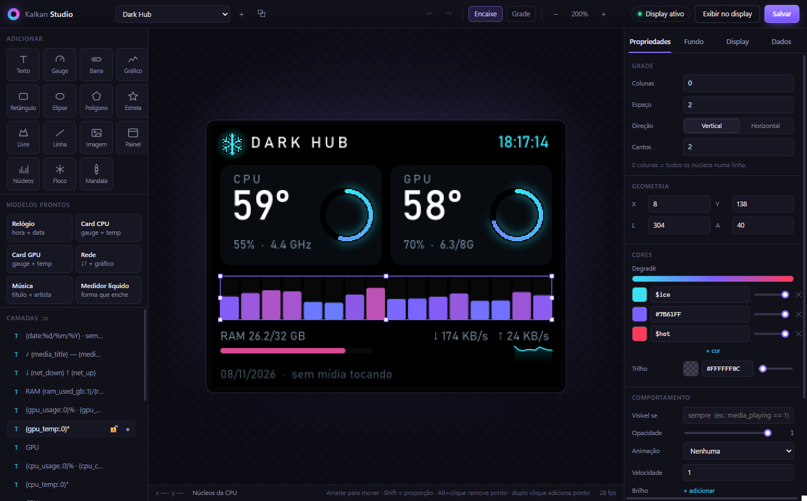
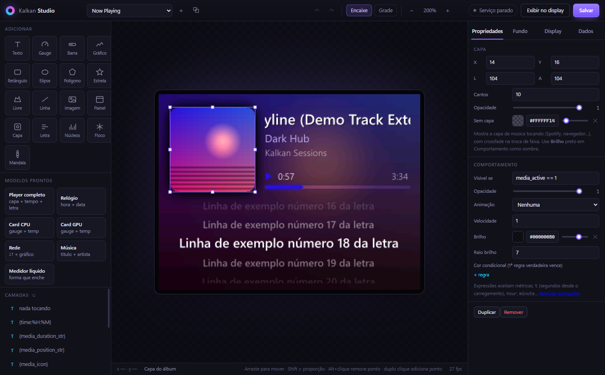

# Kalkan Studio

O Studio é o editor visual de temas, feito em Tauri 2 (WebView2 + Rust). O canvas central é desenhado pelo **mesmo motor** que alimenta o display, usando telemetria real e passando pela conversão RGB565. O que aparece no editor é exatamente o que o painel vai mostrar.

Há duas formas de abrir:
- pelo menu da bandeja, em **Abrir Kalkan Studio…**;
- executando `kalkan-studio.exe`, que precisa estar na mesma pasta do `kalkan-rs.exe` e de `assets\`.

O Studio roda em um processo separado (~45 MB, por causa do WebView2) e só precisa ficar aberto enquanto você edita. O serviço do display continua leve.

## Layout

| Área | Função |
|---|---|
| **Barra superior** | Escolha de tema, novo/duplicar, desfazer/refazer, encaixe, grade, zoom, status do serviço, **Exibir no display** e **Salvar** |
| **Adicionar** | Texto, gauge, barra, gráfico, retângulo, elipse, polígono, estrela, forma livre, linha, imagem, painel, **capa**, **letra**, núcleos, floco e mandala |
| **Modelos prontos** | Grupos de camadas pré-montados: **player completo**, relógio, cards de CPU/GPU, rede, música, medidor líquido |
| **Camadas** | Lista da frente para o fundo: arraste para reordenar; os botões à direita ocultam e travam a camada |
| **Canvas** | Selecionar, mover, redimensionar e editar pontos |
| **Propriedades** | Campos do tipo da camada mais a seção **Comportamento**, comum a todas |
| **Fundo** | Tipo de fundo (incluindo **capa** desfocada), importação de mídia, desfoque, escurecimento, nome do tema, fonte padrão e **paleta** |
| **Display** | Brilho, FPS, rotação, inverter/espelhar, modo silencioso, **modo música** e letras, tela de inicialização, backend de GPU, clima |
| **Dados** | Telemetria ao vivo; clique em um nome para copiar o placeholder |

## Edição no canvas

- **Selecionar:** clique na camada; a camada sob o cursor recebe um contorno tracejado.
- **Mover:** arraste. Com **Encaixe** ligado, a camada se alinha às bordas e ao centro da tela e de outras camadas, mostrando guias magenta. Shift trava o movimento em um eixo.
- **Redimensionar:** use as 8 alças. Shift mantém a proporção. Em gauges a alça muda o raio; em textos, o tamanho da fonte.
- **Formas livres e linhas:** os pontos ciano podem ser arrastados. **Duplo clique** em um segmento adiciona um ponto; **Alt+clique** em um ponto remove.

### Atalhos

| Tecla | Ação |
|---|---|
| Setas / Shift+setas | Move 1 px / 10 px |
| Ctrl+Z / Ctrl+Y (ou Ctrl+Shift+Z) | Desfazer / refazer |
| Ctrl+C / Ctrl+V | Copiar / colar camada |
| Ctrl+D | Duplicar |
| Delete | Remover |
| `[` / `]` | Mover para trás / para frente |
| Ctrl+S | Salvar |
| Ctrl+roda do mouse | Zoom |
| Esc | Limpar seleção |

## Inspector

- **Números:** arraste o **rótulo** do campo (por exemplo, "X") para a esquerda ou direita para ajustar o valor; Shift multiplica o passo por 10.
- **Cores:** amostra, campo hex e controle de opacidade (alfa). Nomes da paleta (`$accent`) também são aceitos.
- **Degradês:** lista de paradas de cor com pré-visualização; use "+ cor" para adicionar.
- **Métrica:** aceita um nome da lista ou qualquer **expressão** (`ram_used_gb / ram_total_gb * 100`). Detalhes em [THEMES.md](THEMES.md#expressões).
- **Texto:** clique nos chips para inserir placeholders na posição do cursor, inclusive exemplos com expressão.
- **Comportamento:**
  - `Visível se`, que recebe uma condição;
  - opacidade da camada;
  - animação e velocidade;
  - brilho e raio do brilho;
  - **cores condicionais** (a primeira regra verdadeira vence).

  O link "Reiniciar animações" faz `t` voltar a 0 para você rever entradas e fades.

## Salvar e exibir

- **Salvar** (Ctrl+S) grava o `theme.toml` e guarda o anterior como `theme.toml.bak`. Se o tema estiver ativo, o display atualiza na hora (hot-reload).
- **Exibir no display** define o tema como ativo no `config.toml`, e o serviço troca em cerca de 1 s.
- **Camadas ocultas** não aparecem na pré-visualização, mas **continuam salvas** no arquivo.

## Temas de música

- **Ponto de partida:** use o modelo **Player completo**, ou as ferramentas **Capa** e **Letra**.
- **Fundo:** em **Fundo → Tipo → Capa**, o fundo passa a ser a capa desfocada.
- **Cores que seguem a música:** use `$album_vibrant`, `$album_light`, etc. No editor, essas cores mostram valores de exemplo; no display, seguem a capa tocando.
- **Sem música tocando:** abra o Studio com `KALKAN_DEMO_MEDIA=1` para ter uma faixa fictícia com capa e letra.

## Tela de inicialização

Escolha **Tela de inicialização** na lista de temas para editar a tela que aparece ao ligar o serviço (a padrão é a do Dark Hub). Duração e ativação ficam na aba **Display**.
